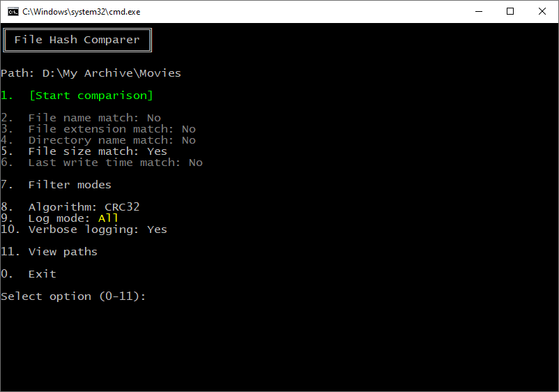
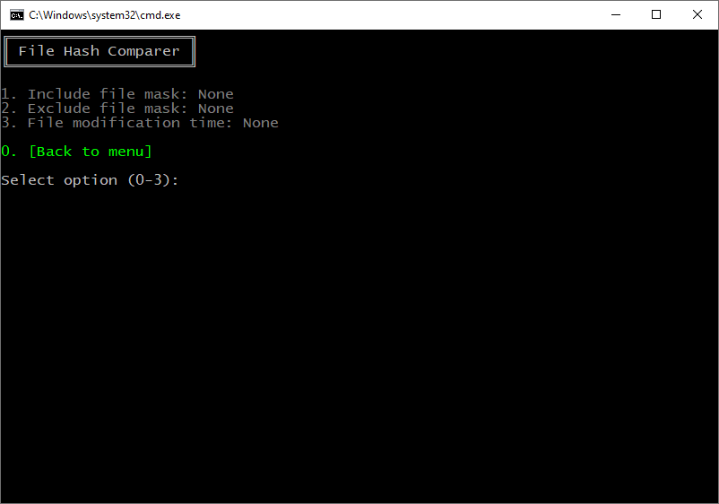
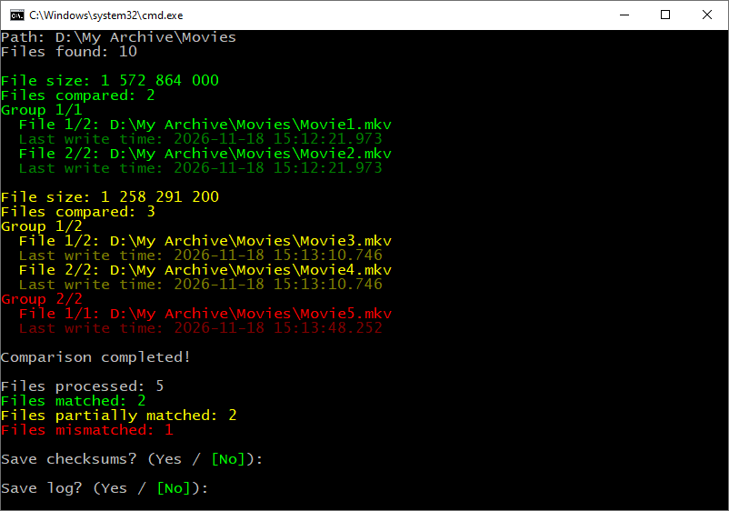

[](README.md) [](README.ru.md)

# File Hash Comparer

**File Hash Comparer** compares files of the same size by hash values and compiles a list for subsequent independent manual inspection of duplicates and file integrity violations.

The utility is a standalone `.bat` file and requires no installation.

## 📖 Usage

### 🚀 Running Without Parameters

When run without parameters (for example, by double-clicking), the utility performs a recursive search and comparison of files starting from the current directory.

### 🖱️ Drag-and-Drop

Files and directories can be dragged directly onto `FileHashComparer.bat`. All specified files are compared against each other, including those found through recursive searches within the specified directories.

### 💻 Running from the Command Line

The utility accepts command-line arguments, including paths to files and directories.

Files and directories can be specified as two sets of paths separated by a double hyphen `--`. Files in the first (source) set are compared only with files from the second (target) set of paths.

Paths to files and directories can be specified using the `?` and `*` wildcards in the last path component.

## 🖥️ Interface

### 📋 Menu

When the utility is launched, an interactive menu is displayed:



Above the menu, the paths to the file sets are displayed. When there are multiple paths, their count is shown.

| Menu item               | Description                                                                             |
| ----------------------- | --------------------------------------------------------------------------------------- |
| `[Start comparison]`    | Starts file comparison. Used by default when the input is empty and `Enter` is pressed. |
| `File name match`       | Perform file comparison only if their names match, ignoring extensions.                 |
| `File extension match`  | Perform file comparison only if their extensions match.                                 |
| `Directory name match`  | Perform file comparison only if the names of their parent directories match.            |
| `File size match`       | Perform file comparison only when their sizes match. Enabled by default.                |
| `Last write time match` | Perform file comparison only if their last write times match.                           |
| `Filter modes`          | Display filter options menu.                                                            |
| `Algorithm`             | Selects the hash algorithm. Default is `CRC32`.                                         |
| `Log mode`              | Log all comparison results, mismatching files only, or matching files only.             |
| `Verbose logging`       | Set verbose logging mode. Enabled by default.                                           |
| `View paths`            | Displays the list of all path sets. Afterward, prompts the user to create a new list.   |
| `Exit`                  | Exit the utility.                                                                       |

### 🔍 Filter Options

The utility allows comparison to be restricted to files matching the specified filters:



| Menu item                | Description                                                                                                                                      |
| ------------------------ | ------------------------------------------------------------------------------------------------------------------------------------------------ |
| `Include file mask`      | Perform comparison only on files matching the specified mask. No mask is set by default.                                                         |
| `Exclude file mask`      | Perform comparison only on files that do not match the specified mask. No mask is set by default.                                                |
| `File modification time` | Perform comparison only on files created or modified within the specified time period before the check starts. No time period is set by default. |
| `[Back to menu]`         | Return to the previous menu. Used by default when the input is empty and `Enter` is pressed.                                                     |

When empty or invalid file masks or file modification time are specified, the filter will be reset.

File name masks are specified using the standard wildcard characters `*`, `?`, `[`, and `]`. The backtick `` ` `` is used to escape wildcard characters. The vertical bar `|` is used as the mask separator. If the mask contains a backslash `\`, it is applied to the full file path.

The menu item `File modification time` allows comparison of only files that are no older than the specified creation or last write time. The utility ignores the time when a file was renamed or moved from another folder on the same drive.

The source and target sets each have their own independent set of filters.

### 📝 Comparison Results

During the comparison, information about matching and mismatching hashes is displayed:



Files placed in the same group have identical sizes and hashes.

When the operation is complete, the utility will prompt you to save the checksums of the processed files and the comparison log. Checksum entries are grouped by file sizes and hash values.

## 💻 Command-line Options

The command-line syntax is as follows:

```cmd
FileHashComparer.bat [options, paths to files of the common or source set in any order] [-- paths to files of the target set]
```

| Option                                                | Description                                                                                                                               |
| ----------------------------------------------------- | ----------------------------------------------------------------------------------------------------------------------------------------- |
| `--`                                                  | Separator between the source and target sets of file paths. All options specified after the separator are interpreted as paths.           |
| `-r`, `--run`                                         | Run file comparison without displaying the menu or prompting to save checksums and the log.                                               |
| `-s`, `--skip-size-match`                             | Skip the file comparison condition that requires matching file sizes. This condition is enabled by default.                               |
| `-n`, `--name-match`                                  | Perform file comparison only if their names match, ignoring extensions.                                                                   |
| `-e`, `--extension-match`                             | Perform file comparison only if their extensions match.                                                                                   |
| `-d`, `--directory-name-match`                        | Perform file comparison only if the names of their parent directories match.                                                              |
| `-t`, `--last-write-time-match`                       | Perform file comparison only if their last write times match.                                                                             |
| `-i`, `--log-mismatches`                              | Log only file mismatches.                                                                                                                 |
| `-m`, `--log-matches`                                 | Log only file matches.                                                                                                                    |
| `-v`, `--no-verbose`                                  | Disable verbose logging mode. Enabled by default.                                                                                         |
| `-c`, `--save-checksums`                              | Save checksums without prompting for confirmation.                                                                                        |
| `-l`, `--save-log`                                    | Save the log without prompting for confirmation.                                                                                          |
| `-q`, `--quiet`                                       | Disable output of comparison results to the console.                                                                                      |
| `-b`, `--batch`                                       | Disable screen clearing and pause.                                                                                                        |
| `--md5`, `--sha1`, `--sha256`, `--sha384`, `--sha512` | Select the hashing algorithm. Default is `CRC32`.                                                                                         |
| `--include=$`                                         | Perform comparison only for files from the common or source file set matching the specified mask, where `$` is the mask value.            |
| `--exclude=$`                                         | Perform comparison only for files from the common or source file set not matching the specified mask, where `$` is the mask value.        |
| `--minutes=#`                                         | Perform comparison only for files from the common or source set no older than the specified time, where `#` is the time value in minutes. |
| `--hours=#`                                           | Perform comparison only for files from the common or source set no older than the specified time, where `#` is the time value in hours.   |
| `--days=#`                                            | Perform comparison only for files from the common or source set no older than the specified time, where `#` is the time value in days.    |
| `--months=#`                                          | Perform comparison only for files from the common or source set no older than the specified time, where `#` is the time value in months.  |
| `--years=#`                                           | Perform comparison only for files from the common or source set no older than the specified time, where `#` is the time value in years.   |
| `--target-include=$`                                  | Perform comparison only for files from the target set matching the specified mask, where `$` is the mask value.                           |
| `--target-exclude=$`                                  | Perform comparison only for files from the target set not matching the specified mask, where `$` is the mask value.                       |
| `--target-minutes=#`                                  | Perform comparison only for files from the target set no older than the specified time, where `#` is the time value in minutes.           |
| `--target-hours=#`                                    | Perform comparison only for files from the target set no older than the specified time, where `#` is the time value in hours.             |
| `--target-days=#`                                     | Perform comparison only for files from the target set no older than the specified time, where `#` is the time value in days.              |
| `--target-months=#`                                   | Perform comparison only for files from the target set no older than the specified time, where `#` is the time value in months.            |
| `--target-years=#`                                    | Perform comparison only for files from the target set no older than the specified time, where `#` is the time value in years.             |

### ⚠️ Command-Line Limitations

Paths and options containing spaces or special CMD command-line characters (for example, `|`, `&` and `^`) must be enclosed in quotation marks.

Relative paths are resolved relative to the current directory. When using UNC paths, the full path must be specified, as CMD does not support UNC paths as the current directory.

It is recommended to use a console font that supports Unicode characters.

### 💡 Command-Line Examples

Compare the files `Movie1.mkv` and `Movie2.mkv` without displaying the menu:

```cmd
FileHashComparer.bat --run Movie1.mkv Movie2.mkv
```

Compare files with the extensions `.mkv` and `.avi` no older than one day in the `Movies` directory without displaying the menu:

```cmd
FileHashComparer.bat --run --include="*.mkv|*.avi" --days=1 Movies
```

Compare files in the directory `D:\My Archive\Movies` with files in the directory `E:\MoviesOld` when their names and extensions match, saving checksums and the log without displaying the menu or console results (grouping of short options):

```cmd
FileHashComparer.bat -rneclq "D:\My Archive\Movies" -- E:\MoviesOld
```

### 🚦 Exit Codes

| Code  | Description                       |
| ----- | --------------------------------- |
| `0`   | No errors.                        |
| `1`   | Files not found.                  |
| `2`   | Command-line error.               |
| `4`   | Execution errors.                 |
| `8`   | Files mismatched.                 |
| `16`  | Files not compared.               |
| `32`  | Files for comparison not found.   |
| `64`  | Error writing the checksums file. |
| `128` | Error writing the log file.       |

Exit codes are bit flags and can be combined when multiple errors occur:

```text
4 + 8 + 16 = 28
```

## ⚙️ Technical Details

The utility is implemented as a standalone `.bat` file with an embedded PowerShell script.

A small part of the BAT file is responsible for launching PowerShell and passing the arguments.

The PowerShell part handles the main logic.

Hash calculation is performed only for files of the same size.

The `FileHashComparer.bat` file itself is ignored during comparison.

## 💻 Recommended system requirements

Windows 10 with PowerShell 5.1 and .NET Framework 4.6.2 or later is recommended for running the utility.

## 📄 License

Standard MIT License. License information is available in the LICENSE file.
