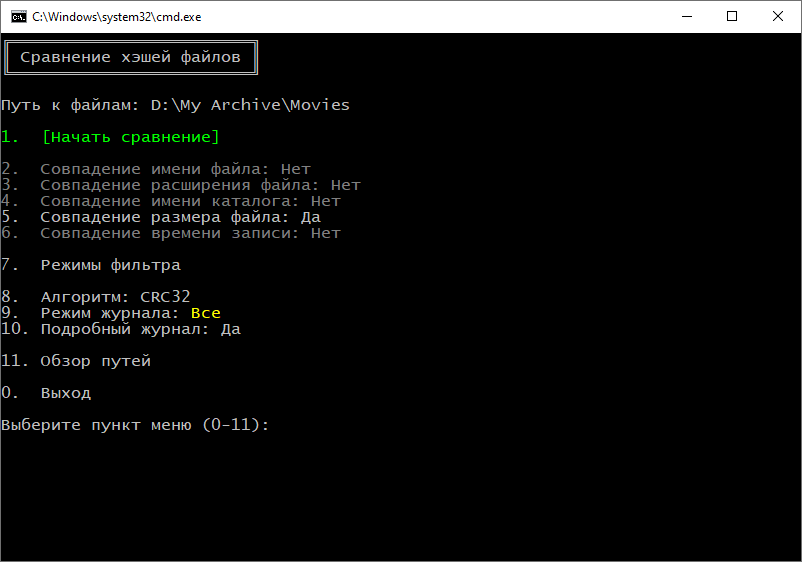
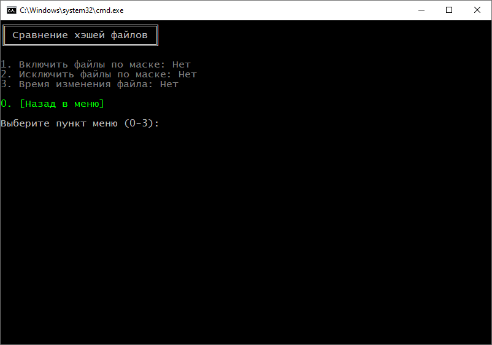
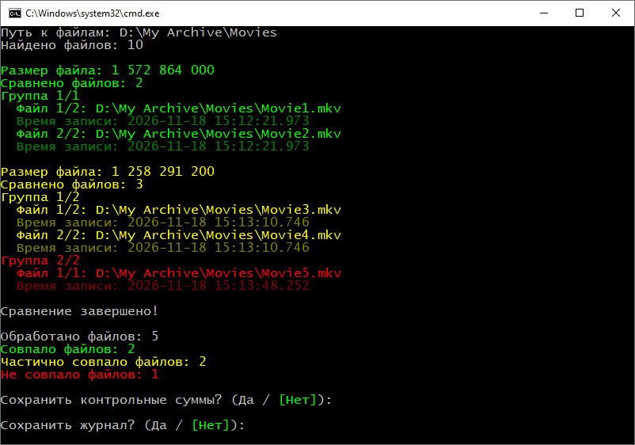

[](README.md) [](README.ru.md)

# File Hash Comparer

**File Hash Comparer** сравнивает файлы одинакового размера по значению хэшей и составляет список для последующего самостоятельного ручного поиска дубликатов и нарушений целостности файлов.

Утилита представляет собой автономный `.bat`-файл и не требует установки.

## 📖 Использование

### 🚀 Запуск без параметров

При запуске без параметров (например, двойным кликом) утилита выполняет рекурсивный поиск и сравнение файлов от текущего каталога.

### 🖱️ Перетаскивание

Файлы и каталоги можно перетаскивать непосредственно на `FileHashComparer.bat`. Сравнение выполняется между всеми указанными файлами, в том числе найденными при рекурсивном поиске в указанных каталогах.

### 💻 Запуск с использованием командной строки

Утилита принимает аргументы командной строки, в том числе пути к файлам и каталогам.

Файлы и каталоги могут быть указаны двумя наборами путей, которые разделяются двойным дефисом `--`. Файлы в первом (исходном) наборе сравниваются только с файлами из второго (сравниваемого) набора путей.

Пути к файлам и каталогам могут быть указаны с использованием подстановочных знаков `?` и `*` в последнем компоненте пути.

## 🖥️ Интерфейс

### 📋 Меню

После запуска утилиты на экран выводится интерактивное меню:



Над меню выводятся пути к наборам файлов. При нескольких путях указывается их количество.

| Пункт меню                    | Описание                                                                                                 |
| ----------------------------- | -------------------------------------------------------------------------------------------------------- |
| `[Начать сравнение]`          | Запуск сравнения файлов. Используется по умолчанию при пустом вводе и нажатии `Enter`.                   |
| `Совпадение имени файла`      | Выполнение сравнения файлов только при совпадении их имён без учёта расширений.                          |
| `Совпадение расширения файла` | Выполнение сравнения файлов только при совпадении их расширений.                                         |
| `Совпадение имени каталога`   | Выполнение сравнения файлов только при совпадении имён их родительских каталогов.                        |
| `Совпадение размера файла`    | Выполнение сравнения файлов только при совпадении их размеров. По умолчанию включено.                    |
| `Совпадение времени записи`   | Выполнение сравнения файлов только при совпадении их времени записи.                                     |
| `Режимы фильтра`              | Отображение меню режимов фильтра.                                                                        |
| `Алгоритм`                    | Выбор алгоритма хэширования. По умолчанию выбран `CRC32`.                                                |
| `Режим журнала`               | Вывод в журнал результатов всех выполненных сравнений, только несовпадений или только совпадений файлов. |
| `Подробный журнал`            | Установка режима подробного вывода в журнал. По умолчанию режим включён.                                 |
| `Обзор путей`                 | Вывод на экран списка всех наборов путей. По окончании выводится запрос на создание нового списка.       |
| `Выход`                       | Выход из утилиты.                                                                                        |

### 🔍 Режимы фильтра

Утилита позволяет ограничить сравнение только для файлов по заданным фильтрам:



| Пункт меню                 | Описание                                                                                                                                         |
| -------------------------- | ------------------------------------------------------------------------------------------------------------------------------------------------ |
| `Включить файлы по маске`  | Выполнение сравнения только для файлов, соответствующих заданной маске. По умолчанию маска не задана.                                            |
| `Исключить файлы по маске` | Выполнение сравнения только для файлов, не соответствующих заданной маске. По умолчанию маска не задана.                                         |
| `Время изменения файла`    | Выполнение сравнения только для файлов, изменённых не ранее указанного периода времени до начала проверки. По умолчанию период времени не задан. |
| `[Назад в меню]`           | Возврат в предыдущее меню. Используется по умолчанию при пустом вводе и нажатии `Enter`.                                                         |

При указании пустых или ошибочных масок и времени изменения файла значение фильтра будет сброшено.

Маски имён файлов задаются с использованием стандартных подстановочных знаков `*`, `?`, `[`, `]`. Для экранирования подстановочных знаков используется обратный апостроф `` ` ``. В качестве разделителя масок используется вертикальная черта `|`. Если маска содержит обратную косую черту `\`, она применяется к полному пути к файлу.

Пункт меню `Время изменения файла` позволяет сравнивать только файлы не старше заданного времени создания или записи. Утилита не учитывает время переименования или переноса файла из другой папки того же диска.

Исходный и сравниваемый наборы имеют собственные независимые наборы фильтров.

### 📝 Результаты сравнения

В процессе сравнения выводится информация о совпавших и несовпавших хэшах:



Файлы, попавшие в одну группу, совпадают по размеру и хэшу.

По завершении работы утилита предложит сохранить контрольные суммы обработанных файлов и журнал сравнения. Записи контрольных сумм группируются по размерам файлов и значениям хэшей.

## 💻 Параметры командной строки

Синтаксис командной строки выглядит следующим образом:

```cmd
FileHashComparer.bat [параметры, пути к файлам общего или исходного набора в любом порядке] [-- пути к файлам сравниваемого набора]
```

| Параметр                                              | Описание                                                                                                                                  |
| ----------------------------------------------------- | ----------------------------------------------------------------------------------------------------------------------------------------- |
| `--`                                                  | Разделитель исходного и сравниваемого наборов путей к файлам. Параметры, указанные после разделителя интерпретируются как пути.           |
| `-r`, `--run`                                         | Запуск сравнения файлов без вывода меню и запросов на сохранение контрольных сумм и журнала.                                              |
| `-s`, `--skip-size-match`                             | Пропуск условия сравнения файлов только при совпадении их размеров. По умолчанию условие включено.                                        |
| `-n`, `--name-match`                                  | Выполнение сравнения файлов только при совпадении их имён без учёта расширений.                                                           |
| `-e`, `--extension-match`                             | Выполнение сравнения файлов только при совпадении их расширений.                                                                          |
| `-d`, `--directory-name-match`                        | Выполнение сравнения файлов только при совпадении имён их родительских каталогов.                                                         |
| `-t`, `--last-write-time-match`                       | Выполнение сравнения файлов только при совпадении их времени записи.                                                                      |
| `-i`, `--log-mismatches`                              | Выводить в журнал только несовпадения файлов.                                                                                             |
| `-m`, `--log-matches`                                 | Выводить в журнал только совпадения файлов.                                                                                               |
| `-v`, `--no-verbose`                                  | Отключение режима подробного вывода в журнал. По умолчанию режим включён.                                                                 |
| `-c`, `--save-checksums`                              | Сохранение контрольных сумм без запроса подтверждения.                                                                                    |
| `-l`, `--save-log`                                    | Сохранение журнала без запроса подтверждения.                                                                                             |
| `-q`, `--quiet`                                       | Отключение вывода результатов сравнения в консоль.                                                                                        |
| `-b`, `--batch`                                       | Отключение очистки экрана и паузы.                                                                                                        |
| `--md5`, `--sha1`, `--sha256`, `--sha384`, `--sha512` | Выбор алгоритма хэширования. По умолчанию выбран `CRC32`.                                                                                 |
| `--include=$`                                         | Выполнение сравнения только для файлов из общего или исходного набора, соответствующих заданной маске, где `$` - значение маски.          |
| `--exclude=$`                                         | Выполнение сравнения только для файлов из общего или исходного набора, не соответствующих заданной маске, где `$` - значение маски.       |
| `--minutes=#`                                         | Выполнение сравнения только для файлов из общего или исходного набора не старше указанного времени, где `#` - значение времени в минутах. |
| `--hours=#`                                           | Выполнение сравнения только для файлов из общего или исходного набора не старше указанного времени, где `#` - значение времени в часах.   |
| `--days=#`                                            | Выполнение сравнения только для файлов из общего или исходного набора не старше указанного времени, где `#` - значение времени в днях.    |
| `--months=#`                                          | Выполнение сравнения только для файлов из общего или исходного набора не старше указанного времени, где `#` - значение времени в месяцах. |
| `--years=#`                                           | Выполнение сравнения только для файлов из общего или исходного набора не старше указанного времени, где `#` - значение времени в годах.   |
| `--target-include=$`                                  | Выполнение сравнения только для файлов из сравниваемого набора, соответствующих заданной маске, где `$` - значение маски.                 |
| `--target-exclude=$`                                  | Выполнение сравнения только для файлов из сравниваемого набора, не соответствующих заданной маске, где `$` - значение маски.              |
| `--target-minutes=#`                                  | Выполнение сравнения только для файлов из сравниваемого набора не старше указанного времени, где `#` - значение времени в минутах.        |
| `--target-hours=#`                                    | Выполнение сравнения только для файлов из сравниваемого набора не старше указанного времени, где `#` - значение времени в часах.          |
| `--target-days=#`                                     | Выполнение сравнения только для файлов из сравниваемого набора не старше указанного времени, где `#` - значение времени в днях.           |
| `--target-months=#`                                   | Выполнение сравнения только для файлов из сравниваемого набора не старше указанного времени, где `#` - значение времени в месяцах.        |
| `--target-years=#`                                    | Выполнение сравнения только для файлов из сравниваемого набора не старше указанного времени, где `#` - значение времени в годах.          |

### ⚠️ Ограничения командной строки

Пути и параметры, содержащие пробелы или специальные символы командной строки CMD (например, `|`, `&` и `^`), должны быть заключены в кавычки.

Относительные пути разрешаются относительно текущего каталога. При использовании путей UNC необходимо указывать полный путь, так как CMD не поддерживает пути UNC в качестве текущего каталога.

Рекомендуется использовать консольный шрифт, поддерживающий символы Юникода.

### 💡 Примеры командной строки

Сравнение файлов `Movie1.mkv` и `Movie2.mkv` без вывода меню:

```cmd
FileHashComparer.bat --run Movie1.mkv Movie2.mkv
```

Сравнение файлов с расширениями `.mkv` и `.avi` не старше одного дня в каталоге `Movies` без вывода меню:

```cmd
FileHashComparer.bat --run --include="*.mkv|*.avi" --days=1 Movies
```

Сравнение файлов в каталоге `D:\My Archive\Movies` с файлами в каталоге `E:\MoviesOld` при совпадении их имён и расширений с сохранением контрольных сумм и журнала без вывода меню и результатов в консоль (группировка коротких опций):

```cmd
FileHashComparer.bat -rneclq "D:\My Archive\Movies" -- E:\MoviesOld
```

### 🚦 Коды возврата

| Код   | Описание                              |
| ----- | ------------------------------------- |
| `0`   | Ошибки не обнаружены.                 |
| `1`   | Файлы не найдены.                     |
| `2`   | Ошибка командной строки.              |
| `4`   | Ошибки выполнения.                    |
| `8`   | Файлы не совпали.                     |
| `16`  | Файлы не сравнены.                    |
| `32`  | Файлы для сравнения не найдены.       |
| `64`  | Ошибка записи файла контрольных сумм. |
| `128` | Ошибка записи файла журнала.          |

Коды возврата являются битовыми флагами и могут комбинироваться при возникновении нескольких ошибок:

```text
4 + 8 + 16 = 28
```

## ⚙️ Технические особенности

Утилита реализована как автономный `.bat`-файл со встроенным скриптом PowerShell.

Небольшая часть BAT отвечает за запуск PowerShell и передачу аргументов.

Часть PowerShell отвечает непосредственно за основную логику.

Вычисление хэшей производится только для файлов, имеющих одинаковый размер.

При сравнении сам файл `FileHashComparer.bat` игнорируется.

## 💻 Рекомендуемые системные требования

Для работы утилиты рекомендуется использовать Windows 10 с PowerShell 5.1 и .NET Framework 4.6.2 или новее.

## 📄 Лицензия

Стандартная лицензия MIT. Информация о лицензии находится в файле LICENSE.
